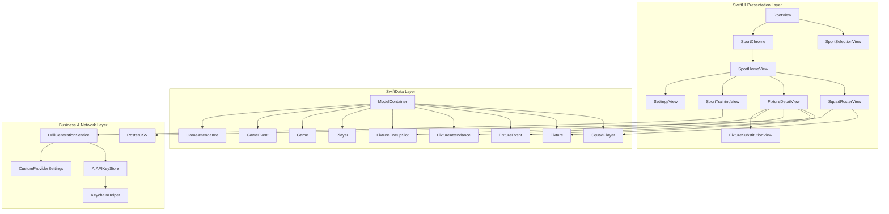

# Coaches Assistant (iOS)

A native iOS and iPadOS application designed for youth and amateur sports coaches to manage team rosters, orchestrate balanced player substitutions, track live game clocks and playing time, log match events, scoring, and discipline, and generate AI-powered practice drills across **15 timed team sports**, plus stats-only scorecards for **Cricket**.

Built with **Swift 6**, **SwiftUI**, **SwiftData**, and **Swift Testing**.

---

## Project Status

- **Architecture**: Native Swift / SwiftUI application supporting iPhone, iPad, and Mac Catalyst.
- **Persistence**: SwiftData local-first SQLite container with schema migration recovery.
- **Multi-Sport Support**: 15 timed team sports organized into **Court Sports**, **Field Sports**, and **Ice & Water Sports** with sport-specific rules, on-field sizes, period formats, scoring systems, and discipline actions — plus **Cricket**, recorded as a batting/bowling/fielding scorecard.
- **AI Practice Drills**: Multi-provider drill generator supporting Google Gemini (`gemini-3.8-flash`), Anthropic Claude (`claude-haiku-4-5`), OpenAI ChatGPT (`gpt-5.6-luna`), and Custom OpenAI-compatible endpoints (Ollama, LM Studio, OpenRouter, Groq, Together.ai).
- **Security & Privacy**: Zero analytics, zero external servers, local-first storage, with API keys securely stored on-device in the iOS Keychain.

---

## Supported Sports & Rules

Coaches Assistant includes built-in rules, period formats, scoring actions, discipline workflows, and optional positional designations across 16 sports:

| Category | Sport | On-Field / Court | Periods | Scoring Actions | Discipline Actions | Positions |
| :--- | :--- | :---: | :--- | :--- | :--- | :--- |
| **Court** | **Basketball** | 5 | 4 Quarters (10 min) | Free Throw (+1), Field Goal (+2), 3-Pointer (+3) | Foul | — |
| **Court** | **Netball** | 7 | 4 Quarters (15 min) | Goal (+1) | Contact, Obstruction, Footwork, Offside | GS, GA, WA, C, WD, GD, GK |
| **Court** | **Futsal** | 5 | 2 Halves (20 min) | Goal (+1) | Yellow Card, Red Card (2 min) | GK, FIX, ALA, PIV |
| **Court** | **Handball** | 7 | 2 Halves (30 min) | Goal (+1) | Yellow Card, 2-Min Suspension, Red Card | GK, LW, LB, CB, RB, RW, PVT |
| **Court** | **Volleyball** | 6 | 2 Halves (25 min) | Point (+1) | Yellow Card, Red Card, Expulsion | S, OH, MB, OPP, L, DS |
| **Field** | **Soccer** | 11 | 2 Halves (45 min) | Goal (+1) | Yellow Card, Red Card (Permanent) | GK, DEF, MID, FWD |
| **Field** | **AFL** | 18 | 4 Quarters (20 min) | Goal (+6), Behind (+1) | Free Kick Against, 50m Penalty | DEF, MID, FWD, RUC, INT |
| **Field** | **Rugby Union** | 15 | 2 Halves (40 min) | Try (+5), Conversion (+2), Penalty Goal (+3), Drop Goal (+3) | Penalty Conceded, Sin Bin (10 min), Sent Off | FRW, LCK, BR, SH, FH, CTR, BCK |
| **Field** | **Rugby League** | 13 | 2 Halves (40 min) | Try (+4), Conversion (+2), Penalty Goal (+2), Field Goal (+1) | Penalty Conceded, Sin Bin (10 min), Sent Off | PRP, HKR, 2RW, LF, HB, FE, CTR, WNG, FB |
| **Field** | **Field Hockey** | 11 | 4 Quarters (15 min) | Goal (+1) | Green Card (2 min), Yellow Card (5 min), Red Card | GK, DEF, MID, FWD |
| **Field** | **Touch Football**| 6 | 2 Halves (20 min) | Touchdown (+1) | Penalty Conceded, Sin Bin (4 min), Sent Off | MID, LNK, WNG |
| **Field** | **Lacrosse** | 10 | 4 Quarters (15 min) | Goal (+1), 2-Point Goal (+2) | Technical Foul (30s), Personal Foul (1 min), Expulsion | G, DEF, LSM, MID, FOGO, ATT |
| **Field** | **Flag Football**| 5 | 2 Halves (20 min) | Touchdown (+6), 1-Pt Conversion (+1), 2-Pt Conversion (+2), Safety (+2) | Penalty, Unsportsmanlike Conduct | QB, C, WR, RB, RUSH, DB, SAF |
| **Ice & Water** | **Ice Hockey** | 6 | 4 Quarters (15 min) | Goal (+1) | Minor Penalty (2 min), Major Penalty (5 min), Misconduct | G, LD, RD, LW, C, RW |
| **Ice & Water** | **Water Polo** | 7 | 4 Quarters (8 min) | Goal (+1) | Exclusion (20s), Brutality / Red Card | GK, CF, CB, WNG, DRV, UTL |
| **Stats Only** | **Cricket** | 11 | Innings (no clock) | Batting card + extras | — | BAT, BWL, AR, WK |

---

## Key Features

### 📋 Roster & Squad Management
- **Multi-Sport Squads**: Manage independent rosters per sport with player names, optional jersey numbers, and sport-specific positions.
- **Duplicate Prevention**: Automated detection and alerting for duplicate player names and shared jersey numbers.
- **CSV Import & Export**: Import rosters from CSV files with automatic column detection (`Name`, `Jersey Number`, `#`, `Player`, `Position`), full quote/comma/line-break handling, header-less files, and duplicate skipping on re-import (with an "Imported N, skipped M" summary); export rosters via the native iOS `ShareLink` share sheet.

### ⏱️ Live Match Clock & Scoreboard
- **Sport-Correct Scoring**: Dedicated score sheet and rapid point logging tailored to each sport's specific scoring rules, lead tracking, and score adjustments.
- **Clock Engine**: Wall-clock delta stopwatch supporting pause, resume, confirmed reset (logged to history), and validated manual time overrides. The clock stops itself at 0:00 so time left running into a break is never credited as playing time.
- **Flexible Match Formats**: Supports Quarters and Halves with configurable period lengths (1–45 minutes), plus unlimited overtime periods (OT 1, OT 2, …).
- **Shift & Bench Timers**: Real-time on-court shift tracking and bench timer calculation measuring time since last sub-off.
- **Game Day Mode**: On by default for a live game/fixture (shown via an on-scoreboard badge, toggleable from the match menu) and keeps the screen awake so the device doesn't auto-lock mid-period. Cleared when **End Game** / **End Fixture** is confirmed.

### 🔄 Lineups & Substitution Engine
- **Starting Lineup Setup**: Visual lineup selector sized exactly to each sport's on-field count (5 to 18 players).
- **Color-Coded Paired Substitutions**: Intuitive substitution interface pairing outgoing and incoming players with numbered, color-coded badges to ensure proper squad count remains on court/field.
- **Attendance & Auto-Benching**: Pre-game and in-game attendance tracking. Marking a player absent automatically benches them from the court and logs a substitution event.

### 📊 Event-Driven Playing Time & Equal Share
- **Reconstructed Court Time**: Playing time is calculated dynamically from the immutable substitution and fixture-end event stream rather than incrementing live counters.
- **Equal-Share Targets**: Calculates each available player's target share of total playing time, surfacing who is ahead or behind to guide fair rotation decisions.
- **Edit & Rollback Resilient**: Correctly recalculates player minutes even when substitutions are modified or deleted retrospectively.

### 🟨 Discipline & Card Management
- **Sport-Specific Penalties**: Record fouls, penalties, green/yellow/red cards, sin bins, suspensions, and exclusions.
- **Temporary & Permanent Removals**: Visual duration tracking for sin bins and timed penalties, with automatic removal from active lineup for send-offs.

### 📝 Timeline, Event Rollback & Coaching Notes
- **Event History**: Chronological log of substitutions, scores, discipline events, MVP votes, period advances, and coaching notes.
- **Event Rollback**: Deleting a score or discipline event automatically reverts scoreboard tallies and restores on-court lineup states.
- **Exporting**: Export full event logs as CSV spreadsheets (every field escaped) and coaching notes as structured text files via native `ShareLink`. Files are written only when shared.

### 🏏 Cricket Scorecards (Stats Only)
- **No clock or rotations**: Cricket records stats rather than running a live match.
- **Match scorecard**: Our batting card (position, runs, balls, 4s, 6s, how out), extras and overs faced; opposition runs/wickets/overs; our bowling figures (overs-maidens-runs-wickets, wides, no-balls); and fielding (catches, run outs, stumpings).
- **Automatic results**: "Won by 20 runs" / "Won by 6 wickets" / "Lost by…" / "Match tied" once a match is marked completed.
- **Season stats**: Batting (average, strike rate, high score, 50s/100s), bowling (best figures, average, economy) and fielding leaderboards, with CSV export of each scorecard and the season.

### 🤖 AI Practice Drill Generator
- **Multi-Sport & Age-Tailored**: Generates targeted practice drills tailored by sport and age group (`U8`, `U10`, `U12`, `U14`, `U16`, `U18`, `Senior`).
- **Supported Providers**:
  - **Google Gemini**: Powered by `gemini-3.8-flash`.
  - **Anthropic Claude**: Powered by `claude-haiku-4-5`.
  - **OpenAI ChatGPT**: Powered by `gpt-5.6-luna` via Responses API.
  - **Custom (OpenAI-Compatible)**: Connect to local or remote endpoints (Ollama, LM Studio, OpenRouter, Groq, Together.ai) with configurable Base URL and Model name.
- **Overridable models**: Each provider's model can be changed in Settings if a provider retires the default.
- **Keychain Security**: All API keys are securely encrypted at rest on-device in the iOS Keychain.

### ⚙️ Data Management & Safety
- **Selective Data Deletion**: Selectively delete players, fixtures/games, or events for a specific sport without affecting other sports.
- **Full Data Reset**: Option to clear all local data across all sports in a single confirmed action.
- **Local-First Privacy**: No telemetry, no third-party tracking, no remote server sync required.

### 📱 Adaptive UI & Appearance
- **iPhone & iPad Layouts**: Compact `TabView` on iPhone and collapsible `NavigationSplitView` sidebar on iPad and Mac Catalyst.
- **Theming**: System, Light, and Dark appearance modes.

---

## Project Structure

```
Coaches Assistant/
├── Coaches Assistant.xcodeproj/           # Xcode project configuration
├── Coaches Assistant/                     # Application source code
│   ├── CoachesAssistantApp.swift         # App entry point & SwiftData ModelContainer
│   ├── Assets.xcassets/                  # Multi-sport app icons and color palettes
│   │
│   ├── Models/                           # SwiftData @Model schema definitions
│   │   ├── Sport.swift                   # Sport enum, rules, scoring, discipline & positions
│   │   ├── TimedMatch.swift              # Clock/period/score/playing-time logic for Fixture
│   │   ├── CricketMatch.swift            # Cricket scorecard + per-player batting/bowling/fielding
│   │   ├── SquadPlayer.swift             # Player entity for every sport (sport, position, jersey)
│   │   ├── Fixture.swift                 # Multi-sport match entity (periods, clock, score)
│   │   ├── FixtureEvent.swift            # Multi-sport match event stream (score, card, sub)
│   │   ├── FixtureAttendance.swift       # Multi-sport match attendance
│   │   ├── FixtureLineupSlot.swift       # Multi-sport on-field position slot assignment
│   │   └── Player / Game / GameEvent / GameAttendance.swift  # Legacy Basketball models, read only by the migration
│   │
│   ├── Services/                         # Business logic, networking, and security
│   │   ├── AIAPIKeyStore.swift           # Observable Keychain manager for AI credentials
│   │   ├── AIProvider.swift              # Supported AI provider enumeration and metadata
│   │   ├── CustomProviderSettings.swift  # UserDefaults storage for custom Base URL & Model
│   │   ├── DrillGenerationService.swift  # Network implementations for Gemini, Claude, OpenAI, Custom
│   │   ├── KeychainHelper.swift          # Security framework wrapper for generic passwords
│   │   ├── RosterCSV.swift               # Standalone RFC-compliant CSV parser, import de-duplication
│   │   ├── LegacyBasketballMigration.swift # One-time copy of Basketball data onto the shared models
│   │   ├── MatchExport.swift             # Event CSV / notes builders and on-demand share files
│   │   └── CricketSeasonStats.swift      # Season batting/bowling/fielding aggregation
│   │
│   └── Views/                            # SwiftUI presentation layer
│       ├── Sport/                        # Multi-sport root and chrome
│       │   ├── RootView.swift            # Root coordinator switching between landing & sport home
│       │   ├── SportSelectionView.swift  # Sport selection grid
│       │   ├── SportHomeView.swift       # Per-sport navigation container
│       │   ├── SportChrome.swift         # Top navigation bar with sport switch action
│       │   └── SportEnvironment.swift    # SwiftUI environment injection for active sport
│       │
│       ├── Shared/
│       │   └── MatchComponents.swift     # Scoreboard, clock, banners & notes for the match screen
│       │
│       ├── Cricket/                      # Stats-only cricket scorecards
│       │   ├── CricketMatchListView.swift
│       │   ├── CricketMatchSetupView.swift
│       │   ├── CricketMatchDetailView.swift
│       │   ├── CricketPlayerStatsEditView.swift
│       │   ├── CricketSeasonStatsView.swift
│       │   └── CricketStatFields.swift
│       │
│       ├── Fixture/                      # Live match screens for every timed sport (Basketball included)
│       │   ├── FixtureListView.swift     # Active and completed fixtures list
│       │   ├── FixtureDetailView.swift   # Main match dashboard (scoreboard, clock, field, notes)
│       │   ├── FixtureSetupView.swift    # New fixture creation modal
│       │   ├── FixtureLineupView.swift   # On-field starting lineup selector
│       │   ├── FixtureSubstitutionView.swift # Color-coded paired substitution interface
│       │   ├── FixtureAttendanceView.swift # Match attendance toggle sheet
│       │   ├── FixtureEventHistoryView.swift # Match event log & deletion rollback
│       │   ├── FixturePlayingTimeView.swift # Minutes played and equal-share summary
│       │   ├── ScoreSheet.swift          # Sport-specific scoring action modal
│       │   └── DisciplineSheet.swift     # Sport-specific card/infraction modal
│       │
│       ├── Roster/                       # Roster management
│       │   ├── SquadRosterView.swift     # Multi-sport squad list, search & CSV import/export
│       │   ├── SquadPlayerEditView.swift # Multi-sport add/edit player modal with position picker
│       │   └── PositionPicker.swift      # Sport-specific position selector
│       │
│       ├── Settings/                     # App settings and credentials
│       │   ├── SettingsView.swift        # Appearance, AI provider config, selective data deletion
│       │   ├── APIKeyInputView.swift     # Secure API key entry sheet
│       │   ├── CustomProviderConfigView.swift # Custom endpoint configuration sheet
│       │   └── DataDeletionSheet.swift   # Selective data deletion modal
│       │
│       └── Training/                     # AI coaching assistant
│           └── SportTrainingView.swift   # Drill generator for every sport
│
├── Coaches AssistantTests/               # Swift Testing unit test suite
│   ├── CoachesAssistantTests.swift      # Test suite entry
│   ├── SportRulesTests.swift            # Rules, scoring, discipline & positions tests
│   ├── SportSymbolTests.swift           # SF Symbol mapping validation tests
│   ├── SportDrillPromptTests.swift      # Multi-sport drill prompt builder tests
│   ├── SquadRosterCSVTests.swift        # Squad CSV import/export validation tests
│   ├── FixtureLineupSlotTests.swift     # Lineup slot assignment and validation tests
│   ├── FixturePlayingTimeTests.swift    # Fixture playing time calculation tests
│   ├── DrillGenerationTests.swift       # LLM response parsing and line wrapping tests
│   ├── MatchClockTests.swift            # Clock math, clamping, and period label tests
│   ├── LegacyBasketballMigrationTests.swift # Basketball data migration tests
│   └── RosterCSVTests.swift             # CSV parser, column discovery, and escaping tests
│
└── Coaches AssistantUITests/             # XCUI automation and launch performance tests
    ├── CoachesAssistantUITests.swift
    └── CoachesAssistantUITestsLaunchTests.swift
```

---

## Architecture & Technical Design



### Key Architectural Highlights

1. **Generalized Multi-Sport Engine**: Configured through declarative `SportRules` structs defining on-field player counts, period structures, scoring point values, discipline rules (temporary sin bins vs permanent send-offs), and positional lists across 15 sports.
2. **Event-Sourced Playing Time Model**: Instead of maintaining fragile running timers per player, playing time is reconstructed mathematically from the `FixtureEvent` / `GameEvent` stream (`.substitutionIn`, `.substitutionOut`, `.fixtureEnd`). This guarantees accuracy regardless of clock pauses, retrospective event editing, or app restarts.
3. **Robust Multi-Provider AI**: The `DrillGenerating` protocol abstracts away differences between Google Gemini (v1beta REST), Anthropic Claude (Messages API), OpenAI (Responses API), and OpenAI-compatible local/remote servers (Chat Completions API).
4. **Secure Credential Storage**: Uses Apple's `Security` framework via `KeychainHelper` to store sensitive API tokens in the device Keychain rather than plain text `UserDefaults`.
5. **Adaptive Presentation**: Seamlessly adapts between compact `TabView` on iPhone and `NavigationSplitView` sidebar on iPad and macOS.
6. **Modern Swift Testing**: Utilizes Apple's native `Testing` framework (`@Test`, `#expect`) for fast, concurrent test execution without legacy `XCTest` overhead.

---

## Getting Started

### Prerequisites
- **macOS Sonoma 14.5+** or **macOS Sequoia 15.0+**
- **Xcode 16.0+**
- **iOS 18.0+** / **iPadOS 18.0+** Deployment Target

### Building and Running
1. Clone the repository:
   ```bash
   git clone https://github.com/lukecarnold-jpg/Basketball-Rotation-iOS.git
   cd "Basketball-Rotation-iOS/Basketball Rotation"
   ```
2. Open `Coaches Assistant.xcodeproj` in Xcode.
3. Select an iOS Simulator (e.g., iPhone 16 Pro or iPad Pro) or a connected physical device.
4. Press `Cmd + R` to build and run the application.

### Running Tests
Run the full test suite using `Cmd + U` in Xcode or via the command line:
```bash
xcodebuild test -project "Coaches Assistant.xcodeproj" -scheme "Coaches Assistant" -destination "platform=iOS Simulator,name=iPhone 16 Pro"
```

---

## Requirements & Permissions
- **Keychain Access**: Generic password read/write for AI API keys (managed securely within the standard app sandbox Keychain).
- **Network Access**: Outbound HTTPS requests to AI provider endpoints when generating practice drills.
- **Local Network Access**: Optional HTTP communication for local OpenAI-compatible endpoints (e.g., Ollama or LM Studio running on a local LAN server).
- **Local Storage**: SwiftData SQLite store managed inside the app container sandbox.

---

## License

Created by Luke Arnold. Distributed under the MIT License.
