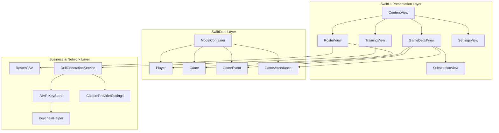

# Coaches Assistant (iOS)

A native iOS and iPadOS application designed for youth and amateur basketball coaches to manage team rosters, orchestrate balanced player substitutions, track live game clocks and playing time, log game events and scores, and generate AI-powered practice drills.

Built with **Swift 6**, **SwiftUI**, **SwiftData**, and **Swift Testing**.

---

## Key Features

### 📋 Roster Management
- **Player Profiles**: Manage full team rosters with player names and optional jersey numbers.
- **Search & Filter**: Real-time roster filtering by player name.
- **CSV Import & Export**: Import rosters from CSV files with automatic column detection (`Name`, `Jersey Number`, `#`, `Player`) and quote/comma escaping; export rosters via the native iOS share sheet.

### ⏱️ Live Game Clock & Scoreboard
- **Scoreboard Controls**: Rapid score logging for field goals (+1 Free Throw, +2 PTS, +3 PTS), point adjustments (+/-), and opponent scoring with live lead tracking.
- **Clock Engine**: High-accuracy stopwatch supporting pause, resume, reset, and manual time overrides.
- **Flexible Game Formats**: Supports Quarters (1st through 4th + OT) and Halves (1st, 2nd + OT) with customizable period lengths (1–25 minutes).
- **Period Transitions**: Automatic period advancement with logged period summaries.

### 🔄 Lineups & Substitution Engine
- **Starting 5 Setup**: Visual 5-player starting lineup selector before tip-off.
- **Color-Coded Paired Substitutions**: Intuitive substitution interface pairing outgoing and incoming players with numbered, color-coded badges to ensure 5 players remain on court.
- **Attendance & Auto-Benching**: Pre-game and in-game attendance tracking. Marking a player absent automatically benches them from the court and logs a substitution event.

### 📊 Event-Driven Playing Time
- **Reconstructed Court Time**: Playing time is calculated dynamically from the immutable substitution and game-end event stream rather than incrementing live counters.
- **Edit & Rollback Resilient**: Correctly recalculates player minutes even when substitutions are modified or deleted retrospectively.
- **Live Indicator**: Real-time ticking indicators and on-court badges showing active players during running clocks.

### 📝 Timeline & Coaching Notes
- **Event History**: Chronological log of substitutions, scores, fouls, MVP votes, period advances, and coaching notes.
- **Event Rollback**: Swiping to delete a score event automatically reverts scoreboard tallies and restores on-court lineup states.
- **Exporting**: Export full event logs as CSV spreadsheets and coaching notes as structured text files.

### 🤖 AI Drill Generator
- **Multi-Provider Architecture**: Generate 5 targeted basketball drills tailored by age group (`U8`, `U10`, `U12`, `U14`, `U16`, `U18`, `Senior`).
- **Supported Providers**:
  - **Google Gemini**: Powered by `gemini-3.8-flash`.
  - **Anthropic Claude**: Powered by `claude-haiku-4-5`.
  - **OpenAI ChatGPT**: Powered by `gpt-5.6-luna` via the Responses API.
  - **Custom (OpenAI-Compatible)**: Connect to local or remote endpoints (Ollama, LM Studio, OpenRouter, Groq, Together.ai) by specifying Base URL and Model name.
- **Keychain Security**: All API keys are securely stored on-device in the iOS Keychain.

### 📱 Adaptive UI & Appearance
- **iPhone & iPad Layouts**: Compact `TabView` on iPhone and collapsible `NavigationSplitView` sidebar on iPad and macOS.
- **Theming**: System, Light, and Dark appearance modes.

---

## Project Structure

```
Coaches Assistant/
├── Coaches Assistant.xcodeproj/           # Xcode project configuration
├── Coaches Assistant/                     # Application source code
│   ├── CoachesAssistantApp.swift         # App entry point, SwiftData ModelContainer & theme setup
│   ├── ContentView.swift                    # Root adaptive layout (TabView / NavigationSplitView)
│   ├── Assets.xcassets/                     # App icons and color sets
│   │
│   ├── Models/                              # SwiftData @Model schema definitions
│   │   ├── Player.swift                     # Player entity (name, jersey number, ID)
│   │   ├── Game.swift                       # Game entity, clock state, lineup & playing time engine
│   │   ├── GameAttendance.swift             # Per-game player attendance and absence flags
│   │   └── GameEvent.swift                  # Event stream (subs, scores, fouls, MVP, notes)
│   │
│   ├── Services/                            # Business logic, networking, and security
│   │   ├── AIAPIKeyStore.swift              # Observable Keychain manager for AI provider credentials
│   │   ├── AIProvider.swift                 # Supported AI provider enumeration and metadata
│   │   ├── CustomProviderSettings.swift     # UserDefaults storage for custom Base URL & Model
│   │   ├── DrillGenerationService.swift     # Networking implementations for Gemini, Claude, OpenAI, Custom
│   │   ├── KeychainHelper.swift             # Security framework wrapper for generic passwords
│   │   └── RosterCSV.swift                  # Standalone RFC-compliant CSV parser and generator
│   │
│   └── Views/                               # SwiftUI presentation layer
│       ├── Game/                            # Game management and live court tracking
│       │   ├── AttendanceView.swift         # Game attendance toggle sheet
│       │   ├── EventHistoryView.swift       # Event timeline, event editing, and deletion rollback
│       │   ├── GameDetailView.swift         # Main game dashboard (scoreboard, clock, court, notes)
│       │   ├── GameListView.swift           # List of active and completed games
│       │   ├── GameSetupView.swift          # New game configuration modal
│       │   ├── LineupSetupView.swift        # Starting 5 and lineup selection modal
│       │   ├── PlayingTimeView.swift        # Total minutes played summary view
│       │   └── SubstitutionView.swift       # Visual paired substitution interface
│       │
│       ├── Roster/                          # Roster management
│       │   ├── PlayerEditView.swift         # Add/edit player modal
│       │   └── RosterView.swift             # Roster list, search, and CSV import/export
│       │
│       ├── Settings/                        # App settings and credentials
│       │   ├── APIKeyInputView.swift        # Secure API key entry sheet
│       │   ├── CustomProviderConfigView.swift # Base URL and model configuration sheet
│       │   └── SettingsView.swift           # Appearance, AI provider config, data counts & reset
│       │
│       └── Training/                        # AI coaching assistant
│           └── TrainingView.swift           # Age group drill generator and upcoming module previews
│
├── Coaches AssistantTests/                # Swift Testing unit test suite
│   ├── CoachesAssistantTests.swift       # Test suite entry
│   ├── DrillGenerationTests.swift           # Output parsing and line wrapping tests for LLM responses
│   ├── GameClockTests.swift                 # Clock math, clamping, and period label tests
│   ├── PlayingTimeTests.swift               # Substitution interval playing time calculation tests
│   └── RosterCSVTests.swift                 # CSV parsing, column discovery, and escaping tests
│
└── Coaches AssistantUITests/              # XCUI automation and launch performance tests
    ├── CoachesAssistantUITests.swift
    └── CoachesAssistantUITestsLaunchTests.swift
```

---

## Architecture & Technical Design



### Key Architectural Highlights

1. **Event-Sourced Playing Time Model**: Instead of maintaining running timers per player, playing time is reconstructed mathematically from the `GameEvent` log (`.substitutionIn`, `.substitutionOut`, `.gameEnd`). This guarantees accuracy regardless of clock pauses, retrospective event editing, or app restarts.
2. **Robust Multi-Provider AI**: The `DrillGenerating` protocol abstracts away differences between Google Gemini (v1beta REST), Anthropic Claude (Messages API), OpenAI (Responses API), and OpenAI-compatible local/remote servers (Chat Completions API).
3. **Secure Credential Storage**: Uses Apple's `Security` framework via `KeychainHelper` to store sensitive API tokens in the device Keychain rather than plain text `UserDefaults`.
4. **Adaptive Presentation**: Reacts to `horizontalSizeClass` to present a 4-tab bar navigation structure on iPhone and a `NavigationSplitView` sidebar on iPad and macOS.
5. **Modern Swift Testing**: Utilizes Apple's native `Testing` framework (`@Test`, `#expect`) for fast, concurrent test execution without `XCTest` legacy overhead.

---

## Getting Started

### Prerequisites
- **macOS Sonoma 14.5+** or **macOS Sequoia 15.0+**
- **Xcode 16.0+**
- **iOS 18.0+** / **iPadOS 18.0+** Deployment Target

### Building and Running
1. Clone the repository:
   ```bash
   git clone https://github.com/lukecarnold-jpg/Coaches-Assistant-iOS.git
   cd "Coaches-Assistant-iOS/Coaches Assistant"
   ```
2. Open `Coaches Assistant.xcodeproj` in Xcode.
3. Select an iOS Simulator (e.g., iPhone 16 Pro or iPad Pro) or a connected physical device.
4. Press `Cmd + R` to build and run the application.

### Running Tests
Run the full test suite using `Cmd + U` in Xcode or via the command line:
```bash
xcodebuild test -project "Coaches Assistant.xcodeproj" -scheme "Coaches Assistant" -destination "platform=iOS Simulator,name=iPhone 16 Pro"
```

---

## Requirements & Permissions
- **Keychain Access**: Generic password read/write for AI API keys (no special entitlement required for standard app sandbox Keychain).
- **Network Access**: Outbound HTTPS requests to AI provider endpoints when generating practice drills.
- **Local Storage**: SwiftData SQLite store managed inside the app container sandbox.

---

## License

Created by Luke Arnold. Distributed under the MIT License.
