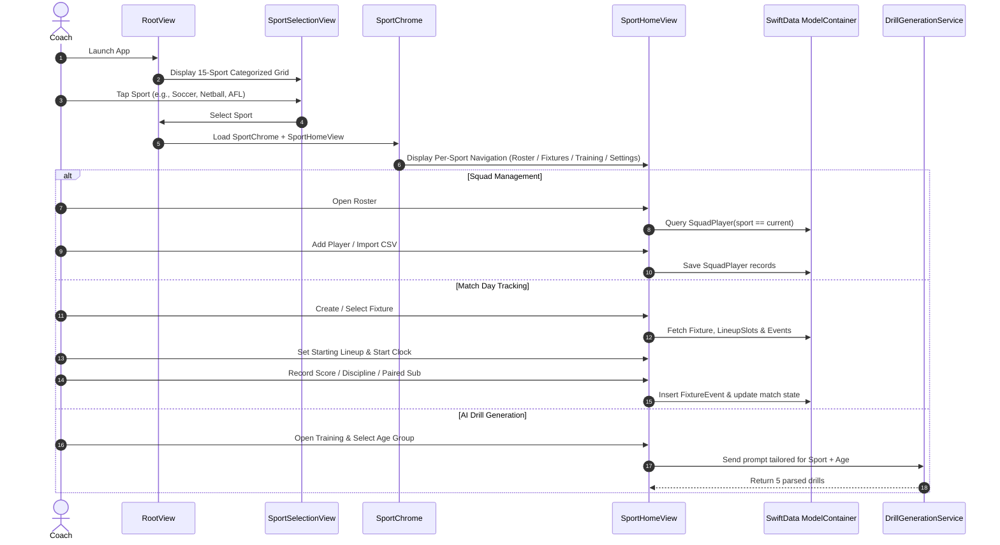

# Project Structure & Architecture

This document describes the organization, file responsibilities, runtime flows, and architectural layers of **Coaches Assistant (iOS)**.

---

## Directory Organization

```
Coaches Assistant/
├── Coaches Assistant.xcodeproj/               # Xcode project configuration and scheme settings
├── Coaches Assistant/                         # Application source code
│   ├── CoachesAssistantApp.swift             # App entry point, SwiftData schema configuration & theme
│   ├── ContentView.swift                     # Basketball navigation (TabView / NavigationSplitView)
│   ├── Assets.xcassets/                      # App icon, accent colors, and asset catalogs
│   │
│   ├── Models/                               # SwiftData @Model schema definitions & Domain Types
│   │   ├── Sport.swift                       # Sport enum, rules, scoring, discipline & positions
│   │   ├── SquadPlayer.swift                 # Multi-sport player entity (sport, position, jersey)
│   │   ├── Fixture.swift                     # Multi-sport match entity (periods, clock, score)
│   │   ├── FixtureEvent.swift                # Multi-sport match event stream (score, card, sub)
│   │   ├── FixtureAttendance.swift           # Multi-sport match attendance
│   │   ├── FixtureLineupSlot.swift           # Multi-sport on-field position slot assignment
│   │   ├── Player.swift                      # Basketball-specific player entity
│   │   ├── Game.swift                        # Basketball-specific game entity
│   │   ├── GameEvent.swift                   # Basketball event stream
│   │   └── GameAttendance.swift              # Basketball attendance
│   │
│   ├── Services/                             # Business logic, networking, and security
│   │   ├── AIAPIKeyStore.swift               # Observable Keychain manager for AI credentials
│   │   ├── AIProvider.swift                  # Supported AI provider enumeration and metadata
│   │   ├── CustomProviderSettings.swift      # UserDefaults storage for custom Base URL & Model
│   │   ├── DrillGenerationService.swift      # Network implementations for Gemini, Claude, OpenAI, Custom
│   │   ├── KeychainHelper.swift              # Security framework wrapper for generic passwords
│   │   └── RosterCSV.swift                   # Standalone RFC-compliant CSV parser and generator
│   │
│   └── Views/                                # SwiftUI presentation layer
│       ├── Sport/                            # Multi-sport root and chrome
│       │   ├── RootView.swift                # Root coordinator switching between landing & sport home
│       │   ├── SportSelectionView.swift      # 15-sport categorized selection grid
│       │   ├── SportHomeView.swift           # Per-sport navigation container
│       │   ├── SportChrome.swift             # Top navigation bar with sport switch action
│       │   └── SportEnvironment.swift        # SwiftUI environment injection for active sport
│       │
│       ├── Fixture/                          # Multi-sport fixture tracking
│       │   ├── FixtureListView.swift         # Active and completed fixtures list
│       │   ├── FixtureDetailView.swift       # Main match dashboard (scoreboard, clock, field, notes)
│       │   ├── FixtureSetupView.swift        # New fixture creation modal
│       │   ├── FixtureLineupView.swift       # On-field starting lineup selector
│       │   ├── FixtureSubstitutionView.swift # Color-coded paired substitution interface
│       │   ├── FixtureAttendanceView.swift   # Match attendance toggle sheet
│       │   ├── FixtureEventHistoryView.swift # Match event log & deletion rollback
│       │   ├── FixturePlayingTimeView.swift  # Minutes played and equal-share summary
│       │   ├── ScoreSheet.swift              # Sport-specific scoring action modal
│       │   └── DisciplineSheet.swift         # Sport-specific card/infraction modal
│       │
│       ├── Game/                             # Basketball-specific match tracking
│       │   ├── GameListView.swift
│       │   ├── GameDetailView.swift
│       │   ├── GameSetupView.swift
│       │   ├── LineupSetupView.swift
│       │   ├── SubstitutionView.swift
│       │   ├── AttendanceView.swift
│       │   ├── EventHistoryView.swift
│       │   └── PlayingTimeView.swift
│       │
│       ├── Roster/                           # Roster management
│       │   ├── SquadRosterView.swift         # Multi-sport squad list, search & CSV import/export
│       │   ├── SquadPlayerEditView.swift     # Multi-sport add/edit player modal with position picker
│       │   ├── PositionPicker.swift          # Sport-specific position selector
│       │   ├── RosterView.swift              # Basketball roster view
│       │   └── PlayerEditView.swift          # Basketball player edit modal
│       │
│       ├── Settings/                         # App settings and credentials
│       │   ├── SettingsView.swift            # Appearance, AI provider config, selective data deletion
│       │   ├── APIKeyInputView.swift         # Secure API key entry sheet
│       │   ├── CustomProviderConfigView.swift # Custom endpoint configuration sheet
│       │   └── DataDeletionSheet.swift       # Selective data deletion modal
│       │
│       └── Training/                         # AI coaching assistant
│           ├── SportTrainingView.swift       # Multi-sport drill generator
│           └── TrainingView.swift            # Basketball drill generator
│
├── Coaches AssistantTests/                   # Swift Testing unit test suite
│   ├── CoachesAssistantTests.swift          # Test suite entry
│   ├── SportRulesTests.swift                # Rules, scoring, discipline & positions tests
│   ├── SportSymbolTests.swift               # SF Symbol mapping validation tests
│   ├── SportDrillPromptTests.swift          # Multi-sport drill prompt builder tests
│   ├── SquadRosterCSVTests.swift            # Squad CSV import/export validation tests
│   ├── FixtureLineupSlotTests.swift         # Lineup slot assignment and validation tests
│   ├── FixturePlayingTimeTests.swift        # Fixture playing time calculation tests
│   ├── DrillGenerationTests.swift           # LLM response parsing and line wrapping tests
│   ├── GameClockTests.swift                 # Clock math, clamping, and period label tests
│   ├── PlayingTimeTests.swift               # Substitution interval playing time tests
│   └── RosterCSVTests.swift                 # CSV parser, column discovery, and escaping tests
│
└── Coaches AssistantUITests/                 # XCUI automation and launch performance tests
    ├── CoachesAssistantUITests.swift
    └── CoachesAssistantUITestsLaunchTests.swift
```

---

## Runtime Flow


